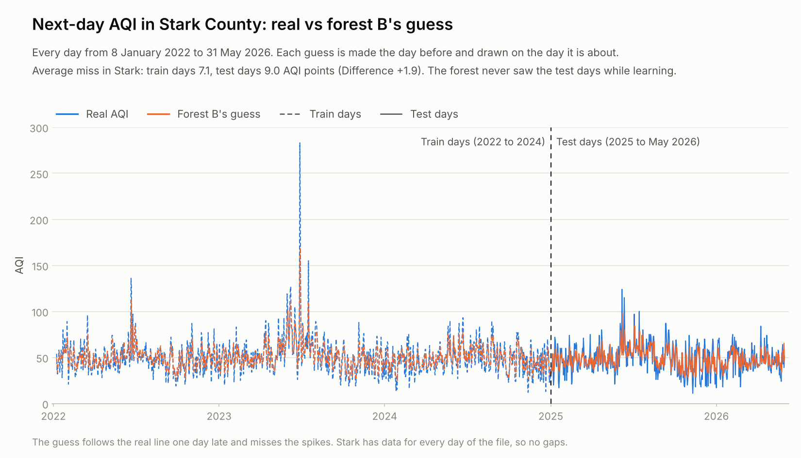
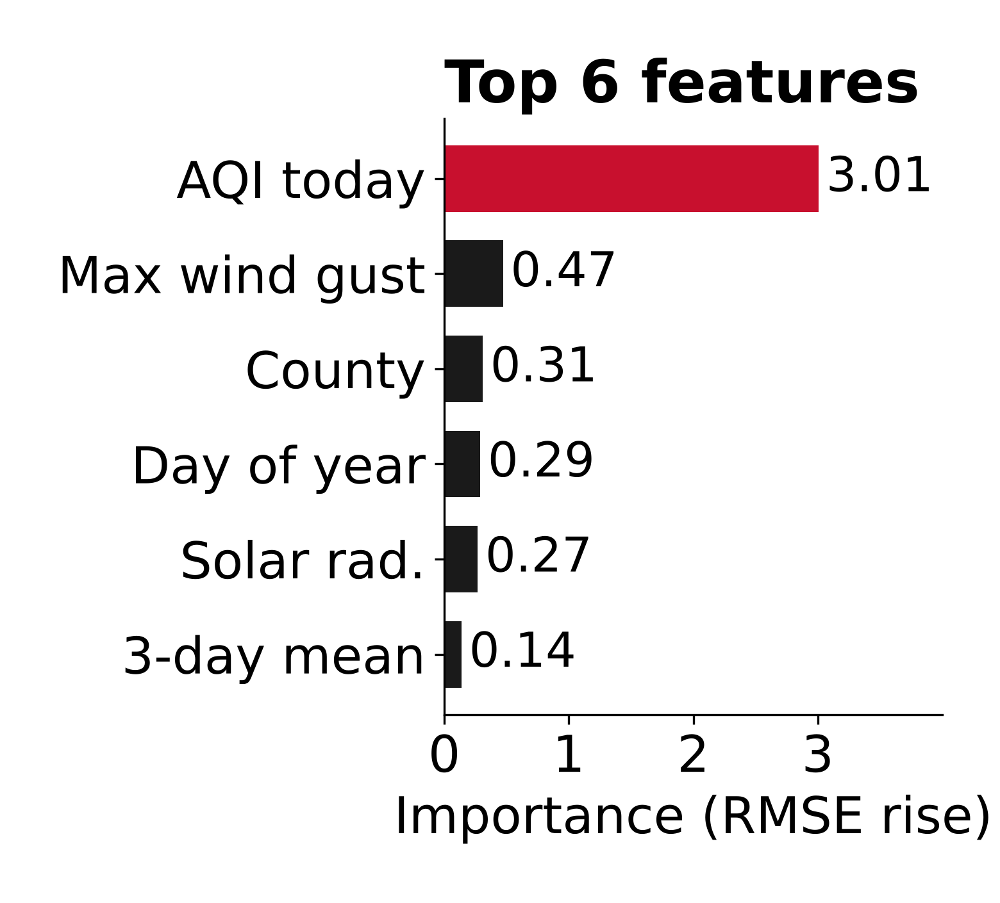

# Predicting Next-Day Air Quality Across Ohio Counties

Can we guess **tomorrow's air quality** in an Ohio county? This project uses today's AQI, the last few days, today's weather and the date to predict the next day's AQI. The data covers 39 Ohio counties from January 2022 to May 2026.

**AQI** is the Air Quality Index (0 to 500, higher is worse): 0-50 is Good, 51-100 is Moderate, and above 100 is unhealthy for sensitive groups.

Course project for **CSCI 6951**, MS Data Science, Youngstown State University. The poster is in [`poster/`](poster/AQI_Ohio_Poster_v3.pdf).



*Stark County: the real AQI and the guess of random forest B, made the day before. Dashed = days the model learned from (2022 to 2024). Solid = days it never saw (2025 to May 2026). The average miss is 7.1 AQI points on the dashed days and 9.0 on the solid days.*

## Results

The data is split by date. The models learn from the days before 2025 (33,669 rows) and are graded on 2025 to May 2026 (14,596 rows), days they have never seen. Each model guesses tomorrow's AQI.

| Model | MAE | RMSE | R² |
|---|---:|---:|---:|
| Baseline (tomorrow = today) | 10.27 | 14.57 | 0.19 |
| Ridge regression | 8.82 | 12.30 | 0.42 |
| Random forest A (default settings) | 8.71 | 12.17 | 0.43 |
| Random forest B (300 trees, depth 12) | 8.56 | 12.03 | 0.45 |
| Hist Gradient Boosting | 8.63 | 12.12 | 0.44 |
| **Tuned random forest** | 8.57 | 12.03 | 0.45 |

MAE is the average miss in AQI points. RMSE is like MAE, but big misses count extra. R² is the share of the ups and downs that the model explains. For MAE and RMSE, smaller is better.

- The best models cut the RMSE by 17% compared with "tomorrow = today" (14.57 to 12.03). The tuned forest and forest B are tied.
- Today's AQI matters most. Next come the wind, the county and the time of year.
- Cuyahoga (average AQI 56.2) and Butler (55.3) have the worst air. Belmont (29.8) has the best air. This counts the 36 counties with at least 365 days of data (Kruskal-Wallis test, p < 0.001).
- The air also changes with the time of year. The poster has the numbers.
- **The models are good on typical days, not on spikes.** All 109 test days with an AQI above 100 were missed.



*How much the error grows when a clue is shuffled (tuned forest, top 6 clues).*

The Part 2 notebook compares 13 models. The poster shows 6.

### More experiments

Extra experiments with forest B, trained on 2022 to 2024 only.

| Figure | What it shows |
|---|---|
| [Stark County, April and May 2026](figures/AQI_Stark_Apr_May_2026.png) | The real AQI and the guess for 61 days. The average miss is 7.8 for the forest and 9.1 for "tomorrow = today". |
| [How far ahead?](figures/AQI_Error_By_Days_Ahead.png) | Tomorrow, the forest beats a plain same-dates average (average miss 7.8 vs 11.1). Further ahead, it is less than 1 point better. |
| [6-month test runs](figures/AQI_6_Month_Test_Runs.png) | Forecasts started on 30 April 2024 and 2025, for May to October. The forest's line stays calm while the real AQI swings. Its six-month average is lower than the real one (45.8 vs 48.6 in 2024, 45.1 vs 49.5 in 2025). |
| [Scenario, May to October 2026](figures/AQI_Scenario_May_Oct_2026.png) | Typical AQI by month for 33 counties, with typical weather assumed. It is a what-if table, **not a real forecast**. The numbers are in [`results/`](results/). |
| [Log of rain and wind](figures/AQI_Log_Before_After.png) | Rain and wind lean to the right. A log makes wind almost symmetric (skew 0.95 to 0.11 for wind speed) but not rain (3.40 to 2.48). |

## Notebooks

The notebooks are made for Google Colab. Click a badge, choose **Runtime > Run all**, and when the first cell asks, upload `AQI_Ohio_2022_2026_with_weather.xlsx` (download it from [`data/`](data/)).

The saved notebooks have no outputs, so the charts appear only after you run them. To look at the charts without running anything, open [`docs/AQI_Chart_Preview.pdf`](docs/AQI_Chart_Preview.pdf) (14 pages, the charts of the walkthrough).

| Notebook | What it does | Run time | Open |
|---|---|---|---|
| [`AQI_Visual_Walkthrough_Colab`](notebooks/AQI_Visual_Walkthrough_Colab.ipynb) | The long walkthrough: the data and every model in 20 steps, with a chart at every step. **Start here.** | about 5 min | [](https://colab.research.google.com/github/Divyansh-Database/ohio-aqi-next-day-prediction/blob/main/notebooks/AQI_Visual_Walkthrough_Colab.ipynb) |
| [`AQI_Interactive_Altair_Colab`](notebooks/AQI_Interactive_Altair_Colab.ipynb) | A short version with 7 interactive charts (zoom, move, hover). | 1 to 2 min | [](https://colab.research.google.com/github/Divyansh-Database/ohio-aqi-next-day-prediction/blob/main/notebooks/AQI_Interactive_Altair_Colab.ipynb) |
| [`AQI_Interactive_Altair_Part2_Colab`](notebooks/AQI_Interactive_Altair_Part2_Colab.ipynb) | 14 more interactive charts: counties, weather, random forest A, Hist Gradient Boosting, a ranking of 13 models, the same 92 days model by model, and a confusion matrix. | 5 to 8 min | [](https://colab.research.google.com/github/Divyansh-Database/ohio-aqi-next-day-prediction/blob/main/notebooks/AQI_Interactive_Altair_Part2_Colab.ipynb) |
| [`AQI_Ohio_Colab`](notebooks/AQI_Ohio_Colab.ipynb) | The poster pipeline: tables, the 6 poster models, tuning and importance. The last cell downloads `results.json` and the figures. | about 15 min | [](https://colab.research.google.com/github/Divyansh-Database/ohio-aqi-next-day-prediction/blob/main/notebooks/AQI_Ohio_Colab.ipynb) |
| [`AQI_Predicted_vs_Real_Colab`](notebooks/AQI_Predicted_vs_Real_Colab.ipynb) | Real vs guessed AQI for one county, with forest B. | about 1 min | [](https://colab.research.google.com/github/Divyansh-Database/ohio-aqi-next-day-prediction/blob/main/notebooks/AQI_Predicted_vs_Real_Colab.ipynb) |

**Earlier, simpler versions** (in `notebooks/earlier_versions/`):

| Notebook | What it does | Run time | Open |
|---|---|---|---|
| [`AQI_Simple_Colab`](notebooks/earlier_versions/AQI_Simple_Colab.ipynb) | The whole project in plain steps, with the same numbers as the poster. | about 2 min | [](https://colab.research.google.com/github/Divyansh-Database/ohio-aqi-next-day-prediction/blob/main/notebooks/earlier_versions/AQI_Simple_Colab.ipynb) |
| [`AQI_Very_Simple_Colab`](notebooks/earlier_versions/AQI_Very_Simple_Colab.ipynb) | A shorter version: 12 clues and 3 models. | under 1 min | [](https://colab.research.google.com/github/Divyansh-Database/ohio-aqi-next-day-prediction/blob/main/notebooks/earlier_versions/AQI_Very_Simple_Colab.ipynb) |
| [`AQI_Very_Simple_Altair_Colab`](notebooks/earlier_versions/AQI_Very_Simple_Altair_Colab.ipynb) | The same, with Altair charts. | under 1 min | [](https://colab.research.google.com/github/Divyansh-Database/ohio-aqi-next-day-prediction/blob/main/notebooks/earlier_versions/AQI_Very_Simple_Altair_Colab.ipynb) |
| [`AQI_Very_Simple_Altair_Quarterly_Colab`](notebooks/earlier_versions/AQI_Very_Simple_Altair_Quarterly_Colab.ipynb) | The same, with the months grouped in quarters (Q1 to Q4). | under 1 min | [](https://colab.research.google.com/github/Divyansh-Database/ohio-aqi-next-day-prediction/blob/main/notebooks/earlier_versions/AQI_Very_Simple_Altair_Quarterly_Colab.ipynb) |
| [`AQI_Simplest_Altair_XGBoost_Colab`](notebooks/earlier_versions/AQI_Simplest_Altair_XGBoost_Colab.ipynb) | The simplest version, with Altair charts and XGBoost. | about 1 min | [](https://colab.research.google.com/github/Divyansh-Database/ohio-aqi-next-day-prediction/blob/main/notebooks/earlier_versions/AQI_Simplest_Altair_XGBoost_Colab.ipynb) |
| [`AQI_Simplest_Scaling_Colab`](notebooks/earlier_versions/AQI_Simplest_Scaling_Colab.ipynb) | The simplest version, with feature scaling. | under 1 min | [](https://colab.research.google.com/github/Divyansh-Database/ohio-aqi-next-day-prediction/blob/main/notebooks/earlier_versions/AQI_Simplest_Scaling_Colab.ipynb) |

## Data

**File:** [`data/AQI_Ohio_2022_2026_with_weather.xlsx`](data/AQI_Ohio_2022_2026_with_weather.xlsx) (4.9 MB). One row is one Ohio county on one day. The data is in `Sheet1`. It has **49,272 rows and 18 columns**, 39 counties, 1,612 days (2022-01-01 to 2026-05-31), and no missing values.

**Source:** the AQI columns come from [EPA AirData](https://aqs.epa.gov/aqsweb/airdata/download_files.html) (daily AQI by county). Daily weather for each county was added to the same file. The file does not say where the weather values come from.

Counties miss some days. The file holds 78.4% of all possible county-days: one county has every day and the others have between 42 and 1,601 days.

| Columns | What they are |
|---|---|
| `State Name`, `State Code`, `county Name`, `County Code`, `Date` | Which county and which day |
| `AQI` | The county's AQI for the day (0 to 285 in this file, average 45.1) |
| `Category` | The AQI in words |
| `Defining Parameter`, `Defining Site`, `Number of Sites Reporting` | The pollutant and the station that gave the AQI, and how many stations reported |
| `Temp Max (°F)`, `Temp Mean (°F)`, `Precipitation (in)`, `Wind Speed Max (mph)`, `Wind Gust Max (mph)`, `Wind Direction (°)`, `Relative Humidity (%)`, `Solar Radiation (MJ/m²)` | Daily weather |

Every column is explained in [`docs/AQI_Data_Definition.pdf`](docs/AQI_Data_Definition.pdf) (2 pages).

| AQI category | AQI | Share of rows |
|---|---|---:|
| Good | 0-50 | 68.3% |
| Moderate | 51-100 | 30.8% |
| Unhealthy for Sensitive Groups | 101-150 | 0.8% |
| Unhealthy | 151-200 | 0.1% |
| Very Unhealthy | 201-300 | less than 0.1% |

The pollutant behind the AQI is ozone in 53.2% of the rows and PM2.5 in 44.2%.

## Method

- **Answer:** tomorrow's AQI in the same county.
- **Clues (20 in the poster models):** today's AQI and the AQI 1, 2 and 6 days ago, the mean of the last 3 and of the last 7 days, the day of the year and the day of the week, whether ozone was today's main pollutant, the wind direction, the county's usual AQI, and 7 weather columns (two temperatures, rain, wind speed, wind gust, humidity, sunlight).
- **Split by date:** train on days before 2025 (33,669 rows), test on 2025 to May 2026 (14,596 rows). The "very simple" and "simplest" notebooks use only 12 clues.
- **Models:** the baseline "tomorrow = today", Ridge regression, random forest A (default settings), random forest B (300 trees, depth 12), Hist Gradient Boosting, and a tuned random forest (random search with 25 tries and cross-validation that keeps the days in time order).
- **Scores:** MAE, RMSE and R² on the test days.

## Run it

**In Colab:** use the badges above.

**On your computer:** the poster scripts need the Excel file in the folder where you run them.

```bash
git clone https://github.com/Divyansh-Database/ohio-aqi-next-day-prediction.git
cd ohio-aqi-next-day-prediction
pip install -r requirements.txt

cd data
python ../scripts/aqi_analysis.py   # the poster pipeline; writes results.json and fig_*.png (several minutes, tuning is the slow part)
python ../scripts/aqi_figures.py    # redraws the poster figures from results.json
```

The files the scripts write (`results.json`, `fig_*.png`) are ignored by git.

## Limits

- The models miss spikes. All 109 test days with an AQI above 100 were missed.
- They use **today's** weather, not a forecast of tomorrow's weather.
- After tomorrow, they are not much better than a plain same-dates average. The 6-month runs and the scenario assume typical weather.
- Counties have different numbers of days, and May 2026 has data for only 8 counties.
- With other library versions, a number can differ in the second decimal.
- This is a student project. For real air quality forecasts, use [AirNow](https://www.airnow.gov).

## Files

| Folder | What is in it |
|---|---|
| [`data/`](data/) | The Excel data file |
| [`notebooks/`](notebooks/) | 5 Colab notebooks, and 6 simpler ones in `earlier_versions/` |
| [`poster/`](poster/) | The poster (version 3), as .pptx and .pdf |
| [`scripts/`](scripts/) | `aqi_analysis.py` (the poster pipeline) and `aqi_figures.py` (the poster figures) |
| [`figures/`](figures/) | The charts used above |
| [`results/`](results/) | The scenario for May to October 2026: `..._daily.csv` (county, date, model forecast, same-dates average) and `..._monthly.csv` (county by month) |
| [`docs/`](docs/) | The data definition and the chart preview (PDF) |

## Credits

Data: US EPA AirData. The code and the notebooks were written with help from Claude (Anthropic).
